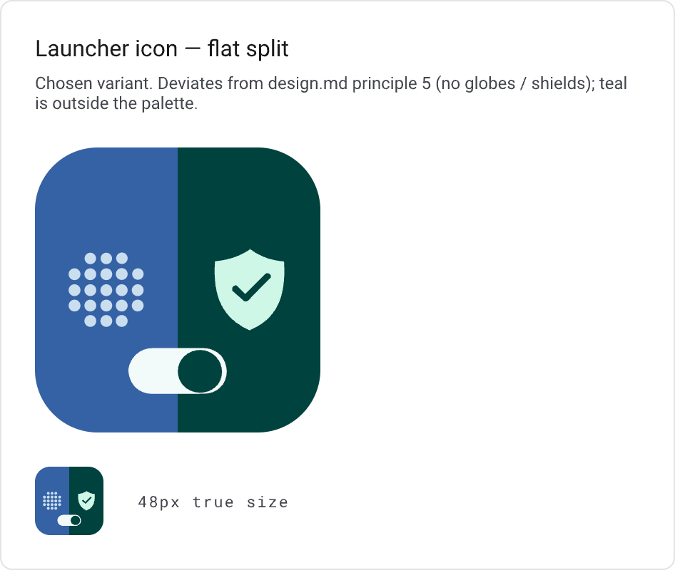
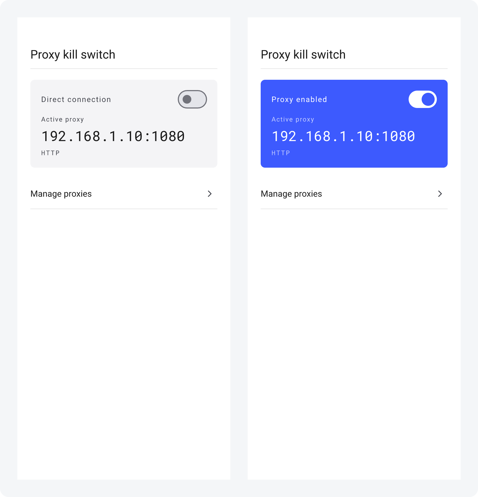
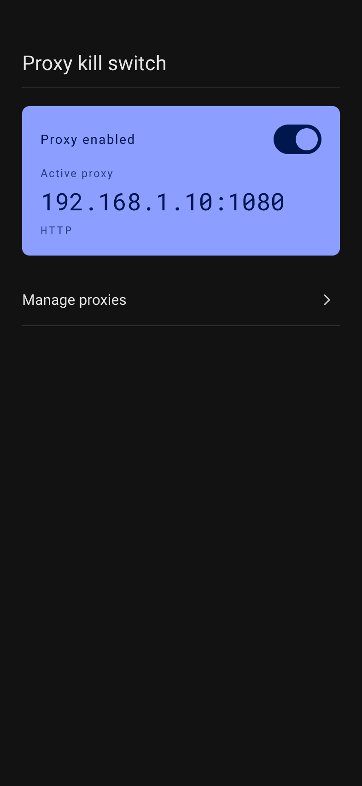
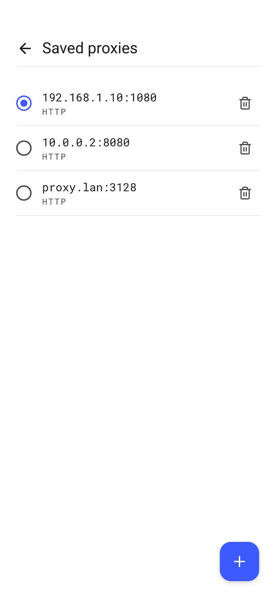
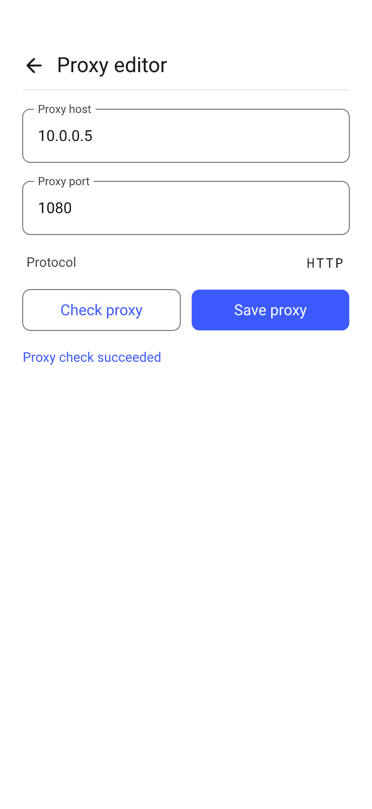
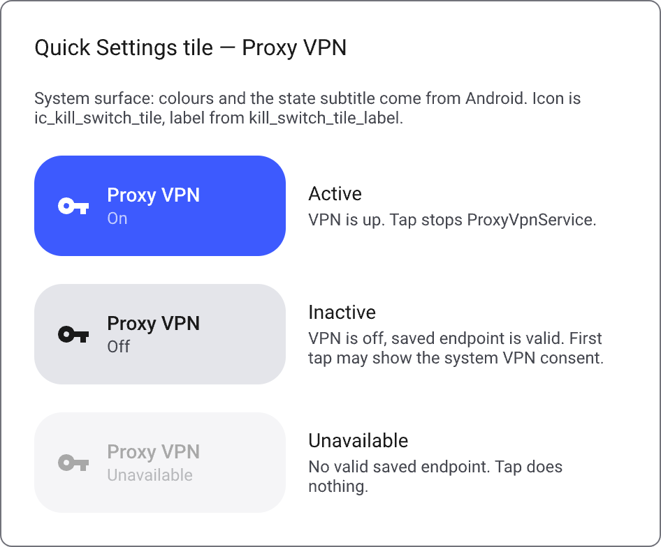

# ProxyKillSwitcher

<p align="center">
  
</p>

**Minimalist, utility-first Android IPv4 kill-switch and HTTP CONNECT proxy tunnel.**  
*Минималистичный системный IPv4 kill-switch и HTTP CONNECT прокси-туннель для Android.*

[English](#-english) • [Русский](#-русский)

<p align="center">
  
  
  
  
  
  
</p>

---

## 📱 Screenshots / Скриншоты



<p align="center">
  <em>Direct connection (VPN off) • Proxy enabled (VPN active)</em>
</p>

<details>
<summary><strong>Дополнительные экраны и тёмная тема / More screens & Dark theme</strong></summary>

<br>

#### Dark Theme / Тёмная тема


#### Saved Proxies & Editor / Сохранённые прокси и редактор



#### Quick Settings Tile / Плитка быстрых настроек Android


</details>

---

## 🇬🇧 English

### Overview

**ProxyKillSwitcher** is an unbloated, distraction-free Android utility designed with one focused objective: route device IPv4 traffic strictly through a verified HTTP CONNECT proxy or keep it completely direct. 

It is **not** a VPN marketplace, **not** a commercial VPN aggregator, and **not** an all-in-one protocol client (no Clash/Xray complex rule parsing). It treats the toggle as a genuine kill-switch instrument: calm, predictable, and transparent.

### Core Principles

1. **The Toggle is the Hero** — Reflects real tunnel state. Until the OS VPN tunnel is established and active, the switch stays off.
2. **Direct Means Direct** — When turned off, traffic flows directly to the internet without intermediate "blackhole" or ghost states.
3. **Verify Before Saving** — Endpoints cannot be saved until connectivity is confirmed via live `Check`. Selecting an active proxy runs a verification check as well.
4. **Frozen Catalog During Active VPN** — While the VPN tunnel is running, proxy profiles are read-only to eliminate race conditions and unexpected mid-connection route swaps.
5. **No Marketing Noise** — No rotating 3D globes, animated locks, neon shields, or onboarding carousels. Clean Material 3 design and system typography.
6. **Zero Telemetry & Tracking** — Your traffic is strictly yours. No analytics SDKs, no external pings, and no crash reporting services.

### Key Features

- **Full Device IPv4 Routing**: Seamless routing of all IPv4 TCP traffic through remote HTTP CONNECT proxy servers via Android's native `VpnService`.
- **Quick Settings Tile**: Control your connection directly from Android's status shade without opening the application.
- **Fail-Safe Recovery**: Graceful fallback to direct connectivity if proxy handshakes fail, accompanied by clear system notifications.
- **Short Screen Stack**: Shallow, intuitive navigation (`Home` → `Saved proxies` → `Proxy editor`).
- **Dynamic System Theme**: Follows Material 3 design guidelines with automatic Dark and Light themes.
- **Strict Quality Enforcement**: Comprehensive automated test coverage, detekt analysis, and ktlint formatting.

### Architecture & Tech Stack

The application is structured following clean multi-module architecture:

```
proxykillswitcher/
├── :app                    # Root Metro DI graph, Application & MainActivity
├── :feature:killswitch     # MVI UI (Home, List, Editor), VpnService, QS Tile, Domain & Repositories
├── :core:tunnel            # SOCKS5 / HTTP CONNECT protocol drivers and tunnel engine
├── :core:designsystem      # Material 3 tokens, theme, typography, and primitives
├── :core:navigation        # Type-safe navigation contracts
├── :core:di                # Metro DI bindings and scopes
├── :core:featuretoggle     # Feature configuration flags
├── :core:preloading        # Startup preloading contracts
└── :core:common            # Shared extensions and dispatchers
```

- **Language & Runtime**: Kotlin 2.3.0, JVM 21, Android SDK 36 (minSdk 26).
- **UI Framework**: Jetpack Compose + Material 3, Edge-to-Edge.
- **State Management**: [Orbit MVI](https://github.com/orbit-mvi/orbit-mvi) (predictable state machines, side effects, and state mappers).
- **Dependency Injection**: [Metro](https://github.com/ZacSweers/metro) (lightweight, compile-time DI).
- **Networking**: Kotlin Coroutines 1.11, Flows, low-level socket-level HTTP CONNECT bridging.
- **Testing**: JUnit 5, Robolectric, Turbine, MockK, Kover.

### Building & Running

#### Prerequisites
- JDK 21
- Android SDK 36 (build-tools 36.0.0, platforms `android-36`)

#### Build Debug APK
```bash
./gradlew assembleDebug
```

#### Signing

Debug builds are signed with the shared keystore committed at `config/signing/debug.keystore`. Studio, CI and local agents therefore produce the same signature, and `adb install -r` updates the app in place instead of reinstalling it. Debug builds carry the `.debug` applicationId suffix, so they can live next to a release build.

The release keystore is never committed. Release builds read it from the environment and fail loudly when it is missing:

| Variable | Purpose |
|---|---|
| `RELEASE_KEYSTORE_PATH` | path to the `.jks` file |
| `RELEASE_KEYSTORE_BASE64` | base64-encoded `.jks`, alternative to the path |
| `RELEASE_KEYSTORE_PASSWORD` | keystore password |
| `RELEASE_KEY_ALIAS` | key alias |
| `RELEASE_KEY_PASSWORD` | key password |

#### Releases & Self-Update

Releases are cut from tags and publish a signed APK to GitHub Releases:

```bash
git tag v1.2.3
git push origin v1.2.3
```

`.github/workflows/release.yaml` derives `versionName` from the tag and `versionCode` as
`major * 10000 + minor * 100 + patch` (`v1.2.3` → `10203`), builds the APK with the release
keystore and uploads `proxykillswitcher-1.2.3.apk` together with its `.sha256`.

| Secret | Purpose |
|---|---|
| `RELEASE_KEYSTORE_BASE64` | base64-encoded release `.jks` |
| `RELEASE_KEYSTORE_PASSWORD` | keystore password |
| `RELEASE_KEY_ALIAS` | key alias |
| `RELEASE_KEY_PASSWORD` | key password |

The installed app checks the latest GitHub release on launch (at most once per six hours), downloads the APK, verifies its version code and signing certificate, and offers a one-tap install. The signing key must never change: a new key cannot update an already installed copy.

Manual release build:

```bash
./gradlew assembleRelease -PappVersionName=1.2.3 -PappVersionCode=10203
```

#### Run Unit Tests & Linting
```bash
./gradlew test ktlintCheck detekt
```

---

## 🇷🇺 Русский

### О проекте

**ProxyKillSwitcher** — это минималистичная утилита для Android, созданная для решения одной конкретной задачи: надёжно направлять весь IPv4-трафик устройства в выбранный HTTP CONNECT прокси или пускать его напрямую.

Это **не** клиент с каталогом публичных серверов, **не** комбайн вроде Clash/Xray со сложной маршрутизацией по правилам и **не** коммерческий VPN-маркетплейс с подписками. Интерфейс спроектирован как рабочий инженерный инструмент: спокойный, предсказуемый и честный.

### Принципы продукта

1. **Тумблер — герой** — Отражает фактическое состояние VPN. Пока туннель не поднят операционной системой, переключатель выключен.
2. **Выключено = прямой интернет** — При отключении трафик идёт напрямую, без зависаний в промежуточных состояниях («туннель поднят, но трафик в blackhole»).
3. **Сначала проверить, потом сохранить** — Кнопка сохранения в редакторе недоступна, пока адрес не прошёл проверку соединением (`Check proxy`). Выбор активного прокси из списка также сопровождается проверкой.
4. **Заморозка каталога при активном VPN** — Пока туннель активен, список и редактор переходят в режим «только чтение». Чтобы изменить конфигурацию, необходимо сначала отключить тумблер.
5. **Спокойная панель, а не реклама** — Никаких вращающихся 3D-глобусов, мигающих щитов, замочков и навязчивого онбординга. Аккуратный Material 3 и чистая системная типографика.
6. **Полная приватность** — Без трекеров, аналитики, рекламных идентификаторов и сторонних сервисов сбора логов.

### Возможности

- **Маршрутизация всего IPv4-трафика**: Прозрачное проксирование трафика приложений через `VpnService` и HTTP CONNECT туннель.
- **Плитка в шторке (Quick Settings)**: Мгновенное включение и выключение прокси прямо из панели быстрых настроек Android (с индикацией трёх состояний: Активен, Неактивен, Недоступен).
- **Защита от сбоев**: Если прокси недоступен, туннель корректно возвращается в исходное состояние с информативным системным уведомлением.
- **Короткий стек экранов**: Простая навигация без перегрузки (`Главный экран` → `Сохранённые прокси` → `Редактор прокси`).
- **Поддержка системной темы**: Полноценная светлая и тёмная тема в соответствии со спецификацией Material 3.
- **Строгий контроль качества**: Полный набор юнит-тестов (Orbit MVI, репозитории, сетевой мост), проверки detekt и форматирование ktlint.

### Архитектура и стек технологий

Проект организован по принципам модульной чистой архитектуры:

```
proxykillswitcher/
├── :app                    # Корневой граф Metro DI, Application и MainActivity
├── :feature:killswitch     # MVI UI (Главная, Список, Редактор), VpnService, QS Tile, Domain и Data
├── :core:tunnel            # Драйверы протоколов SOCKS5 / HTTP CONNECT и движок туннелирования
├── :core:designsystem      # Токены Material 3, темы, шрифты и базовые компоненты
├── :core:navigation        # Типобезопасная навигация
├── :core:di                # Контейнеры и скоупы Metro DI
├── :core:featuretoggle     # Флаги функциональности
├── :core:preloading        # Предзагрузка при старте
└── :core:common            # Общие утилиты и корутинные диспетчеры
```

- **Язык и среда**: Kotlin 2.3.0, JVM 21, Android SDK 36 (minSdk 26).
- **Пользовательский интерфейс**: Jetpack Compose + Material 3, Edge-to-Edge.
- **Управление состоянием**: [Orbit MVI](https://github.com/orbit-mvi/orbit-mvi) (детерминированный конечный автомат состояний и побочных эффектов).
- **Внедрение зависимостей**: [Metro](https://github.com/ZacSweers/metro) (быстрый DI времени компиляции).
- **Сетевой стек**: Kotlin Coroutines 1.11, StateFlow/SharedFlow, мост туннелирования на сокетах.
- **Тестирование**: JUnit 5, Robolectric, Turbine, MockK, Kover.

### Сборка и запуск

#### Требования
- JDK 21
- Android SDK 36 (build-tools 36.0.0, платформа `android-36`)

#### Собрать Debug APK
```bash
./gradlew assembleDebug
```

#### Подпись

Debug-сборки подписываются общим ключом из `config/signing/debug.keystore`, который лежит в репозитории. Поэтому Studio, CI и локальные агенты дают одинаковую подпись, и `adb install -r` обновляет приложение на месте, а не переустанавливает его. Debug-сборка получает суффикс `applicationId` `.debug` и может стоять рядом с релизной.

Релизный ключ в репозиторий не попадает. Релизная сборка читает его из окружения и падает, если чего-то не хватает:

| Переменная | Назначение |
|---|---|
| `RELEASE_KEYSTORE_PATH` | путь к `.jks` |
| `RELEASE_KEYSTORE_BASE64` | `.jks` в base64, альтернатива пути |
| `RELEASE_KEYSTORE_PASSWORD` | пароль хранилища |
| `RELEASE_KEY_ALIAS` | alias ключа |
| `RELEASE_KEY_PASSWORD` | пароль ключа |

#### Релизы и автообновление

Релиз выпускается тегом и публикует подписанный APK в GitHub Releases:

```bash
git tag v1.2.3
git push origin v1.2.3
```

`.github/workflows/release.yaml` берёт `versionName` из тега, считает `versionCode` как
`major * 10000 + minor * 100 + patch` (`v1.2.3` → `10203`), собирает APK релизным ключом и
публикует `proxykillswitcher-1.2.3.apk` вместе с `.sha256`.

| Секрет | Назначение |
|---|---|
| `RELEASE_KEYSTORE_BASE64` | релизный `.jks` в base64 |
| `RELEASE_KEYSTORE_PASSWORD` | пароль хранилища |
| `RELEASE_KEY_ALIAS` | alias ключа |
| `RELEASE_KEY_PASSWORD` | пароль ключа |

Установленное приложение при запуске проверяет последний релиз на GitHub (не чаще раза в шесть часов), скачивает APK, сверяет его version code и подпись с установленными и предлагает установку в одно нажатие. Ключ подписи менять нельзя: новой подписью нельзя обновить уже установленную копию.

Ручная релизная сборка:

```bash
./gradlew assembleRelease -PappVersionName=1.2.3 -PappVersionCode=10203
```

#### Запустить тесты и линтеры
```bash
./gradlew test ktlintCheck detekt
```

---

## 📄 License / Лицензия

Distributed under the **GNU General Public License v3.0** (GPL-3.0). See [`LICENSE`](LICENSE) for more information.

Распространяется под лицензией **GNU General Public License v3.0** (GPL-3.0). Подробности в файле [`LICENSE`](LICENSE).
